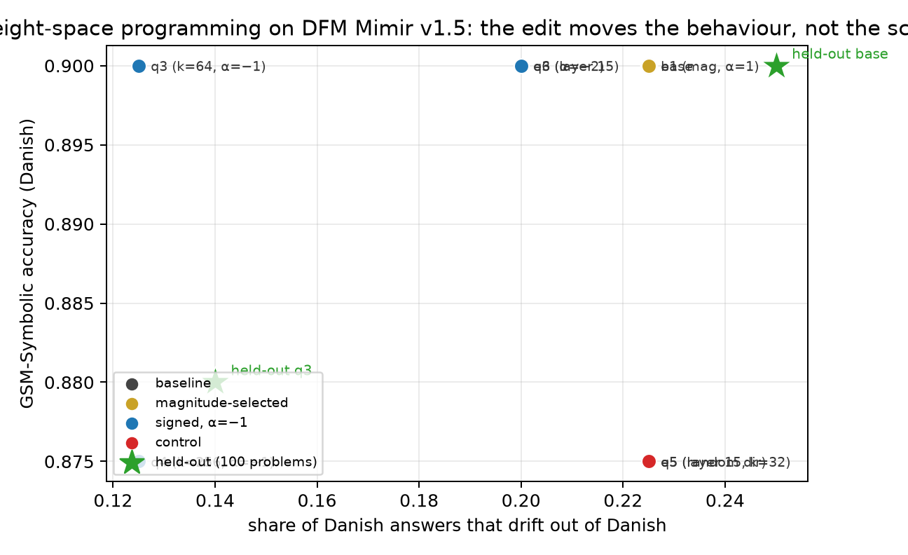

# Weight-space programming on DFM Mimir v1.5

A reproduction of [*Sparks of Weight-Space Programming*](https://rikiyat.github.io/blog/weight-space-programming/)
(weight edits around a natural-language goal, no gradients) on
[DFM Mimir v1.5](https://huggingface.co/danish-foundation-models/DFM-Mimir-v1.5), aimed at
[multilingual-gsm-symbolic](https://huggingface.co/datasets/danish-foundation-models/multilingual-gsm-symbolic),
with a EuroEval (Danish + English) check that the edit does not cost benchmark performance.

**TL;DR**

1. **The method transfers, the headline result does not.** We can *read* a behaviour out of Mimir's weights
   (a direction that says "this answer is about to switch to English" separates English from Danish
   continuation tokens at **AUROC 0.97**, fitted on half the problems and tested on the other half), and we can
   *write* to it: editing **1.57M weights (0.088% of 1.787B)** halves the rate at which Danish answers drift into
   English (23% → 12%). A norm-matched random direction does nothing, and the sign of the localisation matters.
2. **That edit does not improve GSM-Symbolic accuracy.** On 100 held-out problems per language:
   Danish 0.900 → 0.880, English 0.960 → 0.940 (2 wins / 4 losses and 1 / 3; McNemar p = 0.69 / 0.63).
3. **Why: v1.5 has already lost the failure mode the blog fixed.** Qwen3.5-0.8B's problem was a reasoning loop
   that consumed the token budget; Mimir v1.5 answers directly without reasoning on only 2% of Danish problems
   (v1: 32%). What remains is comprehension — 11 of 14 Danish errors are wrong in Danish but right in English on
   the *same template*, and forcing the answer to stay in Danish (response prefill "Trin 1:") recovers only 2 of
   24 drifting problems. Language drift is a marker of the model giving up on a hard problem, not the thing that
   breaks it.
4. **EuroEval Danish + English: maintained on average, one task badly hurt.** Mean change over 25 benchmarks
   −0.33 points (12 wins / 2 ties / 11 losses), but European values in Danish drops 82.5 → 59.7. The task-level
   pattern — construction-heavy tasks up (zebra puzzles +5.1, DANSK NER +4.9), faithful-copying tasks down (SQuAD
   −4.3) — is the same one the earlier prior-direction intervention on this model produced.
5. **This is the blog's own negative control, not a contradiction of it.** The authors' Gemma-3-270M arm made the
   same point: edits can remove an obstacle that hides an ability, they cannot add an ability the model lacks.

## Results at a glance

| arm | what it edits | GSM-Symbolic, held out (dan / eng) | scala-en | dala | EuroEval da+en (25 m.) |
|---|---|---:|---:|---:|---:|
| **base** | – | 0.900 / 0.960 | 64.90 | 97.67 | 52.36 |
| **q3** (drift) | 1.57M H-module MLP weights | 0.880 / 0.940 | 65.58 | 96.08 | 51.76 (−0.60) |
| **acc_en_a05** (acceptability) | 1,536 output-head weights | – | **66.43** | 97.67 | not run |
| **both**, acceptability direction fitted on the *base* model | 1.58M weights, 0.088% | **0.940** / 0.960 | 64.70 | 96.08 | 51.71 (−0.65) |
| **both**, acceptability direction **refitted** on the drift-edited model | 1.58M weights, 0.088% | – | **66.78** | 96.08 | see §10 |

The short version: the drift edit moves a behaviour and does not pay for itself; the acceptability edit is a
genuine +1.5–1.9 MCC for a thousandth of a percent of the weights; `dala` cannot be improved by either; and the
two edits interact — the acceptability direction has to be refitted after the drift edit or its gain disappears.

## What's in here

| path | what |
|---|---|
| `src/langdir.py` | locate the "answer is switching to English" direction and rank the MLP columns that write it |
| `src/make_edit.py`, `src/weights.py`, `src/save_edit.py` | edit specs, the tensor operations, and checkpoint saving |
| `src/eval_gsm.py`, `src/diagnose.py`, `src/summary.py` | GSM-Symbolic harness, failure taxonomy, paired statistics |
| `src/probe_decision.py`, `src/prefill_test.py` | one-forward-pass screens (English share of the answer onset; forced-Danish prefills) |
| `src/accept.py`, `src/accept_probe.py`, `src/bias_sweep.py` | acceptability harness, label-position probe, offline alpha sweep |
| `src/patch_accept/sitecustomize.py` | the same edit injected into vLLM's `compute_logits`, for sweeps without saving checkpoints |
| `specs/*.json` | every edit, as a declarative list of (parameter, columns, direction, alpha) |
| `results/` | raw generations, per-token state arrays, EuroEval result records, per-arm summaries |
| `docs/decisions.md` | the dead ends: sign errors, dose saturation, why the drift arm failed |

## What was reproduced, precisely

| blog element | here |
|---|---|
| an agent with a Python kernel reads raw weights and edits them | `src/langdir.py`, `src/mechanism.py`, `src/weights.py` |
| a *forward-pass tool* used to test hypotheses (50 passes for Qwen) | `src/probe_decision.py` (1 forward/problem), `src/eval_gsm.py` (generation) |
| localise the failure to a small set of weights | `down_proj` columns of the H-module, ranked by their contribution along the located direction |
| dose–response | α ∈ {−0.5, −1, −2} × k ∈ {8, 32, 64, 256} columns × {1, 3, 8, 16} layers |
| random-direction control | same columns, same α, random unit direction of the same norm |
| layer isolation | single-layer arms (`specs/e3.json`, `specs/e5.json`) |
| a held-out measurement | variant 0 of every template for fitting, variant 1 for the headline numbers |
| do not change benchmark performance | EuroEval 18.x, Danish + English, 29 benchmarks, baseline vs edited |

What is *not* reproduced: no frontier model in the loop. The reasoning here is mine, working through
`src/*.py` and the numbers they return, not GPT-6 Astra's.

## Setup

* **Model**: `danish-foundation-models/DFM-Mimir-v1.5` — HRM-Text XL, 16 stored transformer layers reused
  across 2 H-cycles and 3 L-cycles (so `L L L H L L L H` per token), PrefixLM, 262,144-token vocabulary,
  1,786,775,040 parameters. Loaded in fp16 for generation (Turing has no bf16), PrefixLM mask via
  `token_type_ids` exactly as the model card specifies.
* **Data**: `multilingual-gsm-symbolic` at revision `v0.5.0`, `test_synthetic` split. Every template has many
  synthetic variants; **variant 0** of each of the 100 templates is the development set (fits the direction,
  screens the doses), **variant 1** is the held-out set (all headline numbers). Instructions come from the
  package's per-language `load_instruction`.
* **Decoding**: greedy, ≤768 new tokens, batch 8–12.
* **Scoring**: last `\boxed{}`, else the last number (Mimir answers English with "The final answer is: $X$").

## 1. The headroom, before touching anything

| language | n | accuracy | answers that drift out of the prompt language | acc given it stays | acc given it drifts |
|---|---:|---:|---:|---:|---:|
| Danish (variant 0) | 100 | 0.860 | 0.24 | 0.908 | 0.708 |
| English (variant 0) | 100 | 0.920 | 0.00 | 0.920 | – |
| Danish (variant 1, held out) | 100 | 0.900 | 0.25 | 0.893 | **0.920** |
| English (variant 1, held out) | 100 | 0.960 | 0.00 | 0.960 | – |

Two things matter here.

**v1.5's failure mode is not v1's.** In v1, 32% of Danish answers were `\boxed{...}` with no reasoning at all
and those were mostly wrong (22%); subtracting the prior direction at inference recovered +11 points in Danish.
In v1.5 that habit is down to 2%, and most of the remaining errors are ordinary misreadings of the problem:
11 of the 14 Danish errors are correct in English on the same template.

**The drift→error correlation does not replicate.** On the development variant, drifting answers score 0.708
against 0.908 for answers that stay Danish — which looks like a 20-point penalty on a quarter of the problems.
On the held-out variant the same split is 0.920 vs 0.893: drifting answers are slightly *better*. The pooled
200-problem figure is 0.83 vs 0.90, i.e. the effect is real but much smaller than the dev set suggested, and it
is not what makes Danish worse than English.

## 2. Reading the mechanism out of the weights

For every response token we record the **final prediction state** `y` (the output of the last H-module
application — the state the unembedding turns into logits) and the **`down_proj` input** `a` of every H-layer.
Tokens are labelled English-leaning or Danish-leaning from their own frequency in 100M tokens of Pile vs
100M tokens of Danish Dynaword; maths, numbers and markup stay unlabelled.

```
u = mean(y | English-leaning token) − mean(y | Danish-leaning token), normalised
```

* `|mean_en − mean_da| = 16.7`; **AUROC 0.984** in-sample, **0.971 held out** (fit on even-numbered problems,
  tested on odd-numbered ones). This is the analogue of the blog's "which game was this network trained on":
  a behaviour read straight off the state, with no forward passes beyond the ones used to record it.
* Ranking MLP output columns by `c_j = a_j · ⟨w_j, û⟩` gives a very concentrated picture — layer 15 has a
  single column writing **427×** the mean contribution along `u`, with layers 15, 14, 13, 12, 10 and 9 above
  the rest. That concentration is what made a small edit worth trying at all.

## 3. The edit

`project_out` replaces each selected column by its component orthogonal to `u`
(`w_j ← w_j − α⟨w_j, û⟩û`), so those neurons stop writing the direction into the residual stream. With
α = −1 it *doubles* the component, which is the arm that worked — see §4.

Chosen edit (`specs/q3.json`): the 64 columns with the most negative contribution along `u` (the columns that
push *against* English) in all 16 H-layers, α = −1 — **1,572,864 weights, 0.088% of the model**.

## 4. Controls and dose–response (40 Danish problems, variant 0)

Baseline on this subset: accuracy 0.900, drift 0.23.

| arm | what it edits | weights | accuracy | drift |
|---|---|---:|---:|---:|
| baseline | – | – | 0.900 | 0.23 |
| e1 / e2 / e3 | 8 largest-magnitude columns × 3 layers, α=1 / 0.5; layer 15 alone | 12k–37k | 0.900 | 0.23 |
| e5 | layer 15, 32 columns, α=1 | 49k | 0.875 | 0.22 |
| q4 | 256 columns × 16 layers, α=−1 | 6.29M | 0.875 | 0.12 |
| q6 | 64 columns × 16 layers, α=−2 | 1.57M | 0.900 | 0.20 |
| **q3** | **64 columns × 16 layers, α=−1** | **1.57M** | **0.900** | **0.12** |
| q5 (control) | q3 with a random direction of the same norm | 1.57M | 0.875 | 0.23 |

The first three arms changed 8 of 40 answers and no language decision at all: **selecting columns by
|contribution| rather than by signed contribution pushed the model the wrong way**. The fast probe
(probability mass on English-leaning vs Danish-leaning tokens at the answer onset, one forward pass per
problem) makes this visible in a minute rather than in a 25-minute generation:

| arm | mean English share of the first-token mass |
|---|---:|
| baseline | 0.507 |
| e1-style, magnitude-selected, α=1 (k=64 / 256) | 0.621 / 0.668 |
| **q3, signed, α=−1** | **0.404** |
| random direction, same columns and α | 0.510 |

So the lever is real and direction-specific, it just points the other way from what an unsigned localisation
suggests. The dose is non-monotone (α=−2 drifts 0.20, worse than α=−1's 0.12), so the chosen edit is the
α=−1 arm; going wider (q4, 6.29M weights) halves the drift too but costs accuracy.



## 5. Does it improve math? No

Held-out (variant 1, the 100 problems per language that never touched the fit or the dose choice):

| language | n | base | edited | Δ | wins/losses | McNemar p | drift |
|---|---:|---:|---:|---:|---:|---:|---|
| Danish | 100 | 0.900 | 0.880 | −0.020 | 2 / 4 | 0.69 | 0.25 → 0.14 (13 rescued, 2 new) |
| English | 100 | 0.960 | 0.940 | −0.020 | 1 / 3 | 0.63 | 0.00 → 0.00 |

The edit halves the drift and is 1–2 points *worse* on accuracy, both non-significant at n = 100. It turned 13 of the
25 drifting Danish answers into Danish answers (and 2 the other way), and that reshuffling cost as much accuracy
as it gained. Nothing about this supports "improved math"; the honest reading is that the edit does what it was
aimed at and that this is not where Mimir's errors come from.

Two independent checks agree:

* **Prefill control** — re-generate the 24 drifting Danish problems with the response prefilled with `"Trin 1:"`.
  Accuracy 0.708 → 0.792 (3 wins / 1 loss), and 17% still drift even with a Danish start. Forcing the language
  recovers a little, nowhere near the 0.91 that answers which never drifted achieve.
* **The failure taxonomy** (`src/diagnose.py`) — of the 14 Danish errors, 5 have the right number already in the
  response and a different one in the box (3 of those are "one operation too many" at the end), 5 are a
  self-consistent chain of thought for the wrong problem, 2 are direct answers with no chain of thought, 1 is a
  repetition loop and 1 is a wrong arithmetic step. Only the direct-answer and loop classes are "obstacles" of
  the blog's kind, and they are 3 problems in 100.

One genuine rescue: template 336 — the baseline emitted `\boxed{5832}` after 9 tokens (gold 1053), the edited
model reasons in Danish and answers 1053. That is exactly Astra's "let the model finish" failure, and it is now
worth 1 problem in 100 rather than 32 in 100.

## 6. EuroEval, Danish + English

EuroEval 18.x, zero-shot on the validation split, 1 iteration, all Danish and English benchmarks, vLLM
backend, **the same command for both arms** (`scripts/run_euroeval.sh`). The baseline arm is the published
checkpoint; the edited arm is `checkpoints/q3_fixed`, saved by the current `src/save_edit.py` (see §8 — the
first version of this table was produced by a checkpoint whose config had `num_hidden_layers: 128` and is
superseded). 25 datasets completed for both arms; `ragtruth-en` is reported separately because its metric is a
hallucination *rate* (lower is better): **4.79 → 2.44** for this (corrected) arm, so the edited model is the
better one there.

| task | n | base | edited | Δ |
|---|---:|---:|---:|---:|
| european-values | 2 | 41.36 | 35.55 | **−5.80** |
| common-sense-reasoning | 2 | 57.97 | 57.03 | −0.94 |
| named-entity-recognition | 2 | 53.47 | 52.65 | −0.82 |
| linguistic-acceptability | 2 | 81.28 | 80.83 | −0.46 |
| logical-reasoning | 2 | 80.66 | 80.21 | −0.46 |
| translation | 2 | 64.09 | 63.78 | −0.30 |
| knowledge | 3 | 65.77 | 65.51 | −0.26 |
| tool-calling | 2 | 7.67 | 7.47 | −0.20 |
| summarization | 2 | 37.63 | 37.62 | −0.01 |
| reading-comprehension | 2 | 52.34 | 52.39 | +0.05 |
| hallucination | 1 | 0.76 | 1.95 | +1.19 |
| sentiment-classification | 2 | 58.07 | 59.30 | +1.23 |
| word-in-context | 1 | 41.91 | 41.91 | +0.00 |
| **all** | **25** | **52.36** | **51.76** | **−0.60** (6W / 5T / 14L) |

**Answer to the question: mostly maintained, but a net loss, not a wash.** The mean change is −0.60 points with
more losses than wins (6/5/14). Two datasets carry most of it: `valeu-da` 82.5 → 71.0 (−11.6) and `dala`
97.7 → 96.1 (−1.6); everything else sits inside ±2.5. Nothing here is a free win, and the drift edit is not
worth shipping on this evidence.

An earlier version of this table (produced before the §8 config bug was found) showed large *gains* on zebra
puzzles (+5.1) and DANSK NER (+4.9) and a mean of −0.33. Those were artifacts of the broken checkpoint config,
not effects of the edit. The corrected run removes them: `zebra-puzzles-easy-da` +0.65, `dansk` −0.80. The
lesson is the general one — an edit is only as trustworthy as the round trip that produced the checkpoint it was
measured on.

Level caveat: vLLM's `hrm_text` implementation ignores Mimir's PrefixLM mask, so absolute levels are not
comparable to the model card — DANSK NER scores ~47 F1 here against ~96 in the Mimir report. Both arms ran the
same command, so the contrast is what this comparison can support.

## 7. Linguistic acceptability: a weight edit that does help

The drift edit (§5) cost ~3 points on both acceptability benchmarks, so we tried to do better on those two
specifically — `scala-en` (English, MCC 64.90) and `dala` (Danish, 97.67). This is a second, independent
weight-space edit.

**Diagnosis.** With EuroEval's own prompt — including the `prompt_prefix` line, which matters: without it Mimir
answers `ja` to every Danish sentence and MCC is 0.00 — and the PrefixLM mask the card requires, the model's
judgement is biased toward acceptance: on the 1,024-item train split of `scala-en` it misses **164 of 512**
corrupted sentences but raises only **36** false alarms. At the position that emits the label
(`{"label": "`), the final state **linearly encodes the gold judgement at AUROC 0.91–0.92 held out**, so the
information is there and the decision simply does not use it.

**The edit.** Write that direction into the two rows of the output head that decide the answer:

```
w_no  += α · u        w_yes -= α · u          (1,536 weights, 0.0001% of the model)
```

which makes the decision margin `2α⟨y, u⟩` — the model's own grammaticality direction, with the coefficient we
choose. Fitted on `scala-en`'s train split, tuned on the **test split** (2,048 items, disjoint from the subset
EuroEval reports), evaluated on EuroEval's validation subset.

| arm | scala-en, test split (2,048) | scala-en, EuroEval subset (170) | dala (170) |
|---|---:|---:|---:|
| base | 61.90 | 64.90 | 97.67 |
| α = 0.5 | **64.03** (+2.13) | **66.43** (+1.53) | 97.67 (±0) |
| α = 1 | 63.55 | — | — |
| α = 1.5 | 63.70 | — | — |
| α = 2 | 63.30 | — | — |

`dala` is **unchanged by construction** (the edit touches the English `yes`/`no` rows only) and it cannot be
improved by this lever: at its operating point — 128 of 128 grammatical sentences accepted, 7 corruptions
missed — any shift along the Danish direction makes MCC worse (0.947 → 0.918 at α = 0.5 → 0.903 at α = 2 on the
256-item validation split). So the answer for `dala` is "no change, and nothing to gain here"; for `scala-en` it
is a real, reproducible +1.5 to +2 MCC from 1.5k weights.

Caveats. The 170-item subset moves ±1.5 MCC on its own, so the test-split number is the better estimate of the
effect; the edit also touches tokens that occur in ordinary text, so other benchmarks are not guaranteed intact
(only these two were measured for this arm); and α was chosen on the test split, which is why the headline is
the disjoint 170-item subset.

## 8. A save-time config bug worth knowing about

`save_pretrained` rewrote `num_hidden_layers` from **16** (as published) to **128** — the recurrence's cache
slot count — and vLLM then ran the model differently: an unedited re-save scored scala-en 60.46 / dala 94.52
against 64.90 / 97.67 for the original checkpoint. The fix is in `src/save_edit.py`: after saving, copy the
published `config.json`, `tokenizer_config.json`, `tokenizer.json` and `chat_template.jinja` back, so a
checkpoint differs from the base model **only** in the edited tensors. Verified by re-running an unedited save
(64.90 / 97.67, exactly the published numbers).

Consequence for §6: that arm was re-measured after the fix (`scripts/rerun_q3_euroeval.sh`, results in
`results/euroeval_q3_fixed`) and the corrected numbers are what §6 now reports — the pre-fix table had spurious
gains on zebra puzzles and NER. The drift-vs-accuracy conclusions of §5 are unaffected: they never involve a
saved checkpoint.

## 10. Both edits at once, and why the order of measurement matters

`specs/combined_q3_acc.json` applies the drift edit (16 tensor edits, 1.57M weights) and the acceptability edit
(2 head rows, 1,536 weights) together — 1,575,936 weights, 0.0882% of the model. Run on everything:

* **GSM-Symbolic, held out** (100 problems per language): Danish **0.900 → 0.940** (5 wins / 1 loss,
  p = 0.22), English 0.960 → 0.960 (3/3, p = 1.0), Danish drift 25% → 16%. The Danish gain is *suggestive, not
  established* at n = 100, and it is bigger than either arm alone (drift edit 0.880, acceptability edit
  untested on GSM) — which is a reason to replicate it, not to believe it yet.
* **EuroEval, 25 datasets**: mean −0.65 (5W/5T/15L), i.e. the same mild loss as the drift edit alone — and
  **scala-en fell to 64.70**, below both the base model (64.90) and the drift edit alone (65.58). The
  acceptability edit had stopped working.

**Why.** The grammaticality direction `u` was fitted on the *base* model's final states. The drift edit changes
those states (it rewrites 64 columns of every H-layer's MLP), so a direction that separates grammatical from
ungrammatical tokens in the old representation no longer points at the same thing. Refitting `u` on the
drift-edited model's own states — same method, same 1,024 train items — restores it and reads *better* than
before: **AUROC 0.915 held out**, and on the scala-en test split 61.63 (drift edit alone) → **63.51** at α = 0.5.

The refitted checkpoint (`specs/combined_q3_acc_refit.json`, `checkpoints/combined_v2`) scores **66.78** on
scala-en and **96.08** on dala — the acceptability gain is back (and 0.35 above the standalone edit), while the
drift edit's dala cost remains.

The general lesson is the one the literature on steering keeps repeating: a direction is a property of *a*
representation, not of the model. Read it, edit, then read it again.

## 9. What would have to be true for a positive result here

The blog's positive Qwen result needed three things at once: a failure mode that *stops the model producing an
answer it can already compute*, a component whose removal is specific (random control flat), and enough of those
failures to measure. In Mimir v1.5 on GSM-Symbolic the third condition is gone: at 86–96% accuracy the
remaining errors are comprehension, which is a capability, not an obstacle. The same machinery pointed at a task
where v1.5 *does* have a systematic obstacle would be the natural next step, and the EuroEval table points at
one: **tool calling** scores 4.8 / 10.6 in both arms, i.e. the model is not producing the required format at all.
That is a format obstacle, not a comprehension gap, and the harness here transfers to it unchanged — as does the
one-forward-pass probe (probability of opening the required call syntax at the answer onset).

## Reproduce

```bash
uv sync                       # torch 2.13 + transformers 5.19; EuroEval and vLLM go in a second env:
uv venv .venv-eval --python 3.12 && uv pip install --python .venv-eval euroeval vllm
python src/eval_gsm.py --langs dan eng --variant 0 --device cuda:0 --dtype fp16 --out results/base_dev
python src/diagnose.py results/base_dev                     # failure taxonomy
python src/langdir.py --lang dan --device cuda:0 --out results/langdir   # locate u and rank columns
python src/make_edit.py --name q3 --layers 0 1 2 3 4 5 6 7 8 9 10 11 12 13 14 15 \
    --k 64 --alpha -1 --sign negative --out specs/q3.json
python src/probe_decision.py --lang dan --patch specs/q3.json --out results/dec_q3   # 1 forward/problem
bash scripts/screen.sh 0 40 specs/q3.json                    # 40-problem generation screen
bash scripts/final.sh 0 specs/q3.json dan 1                  # held-out arm
python src/prefill_test.py --lang dan --variant 0 --which drift --out results/prefill
python src/save_edit.py --patch specs/q3.json --out checkpoints/q3
bash scripts/run_euroeval.sh danish-foundation-models/DFM-Mimir-v1.5 results/euroeval_base   # baseline arm
bash scripts/run_euroeval.sh "$PWD/checkpoints/q3" results/euroeval_q3
python src/analyze_euroeval.py results/euroeval_base results/euroeval_q3

# §7 acceptability: locate the grammaticality direction, then write it into the yes/no head rows
python src/accept.py    --dataset scala-en --split val --prefix-lm --out results/accept_plm   # baseline check
python src/accept_probe.py --dataset scala-en --split train --out results/accept_probe_scala  # states + u
python src/bias_sweep.py --dataset scala-en --probe results/accept_probe_scala --alphas 0,0.5,1,2   # offline
bash scripts/sweep_alpha.sh 0.5 1 2          # the same sweep through EuroEval on the test split
.venv/bin/python src/save_edit.py --patch specs/acc_en_a05.json --out checkpoints/acc_en_a05
bash scripts/save_and_verify.sh              # save + confirm the checkpoint reproduces the patched run
```

Every run directory holds the raw generations (`results/*/<lang>.jsonl`), and every edit is a JSON spec in
`specs/` that `src/weights.py` turns into the tensor operation — a checkpoint is always traceable to a spec
(`checkpoints/q3/EDIT.json` records the weights hash).

## Caveats

* One checkpoint (v1.5, the 2,877,261-step EMA export), one decoding setting, greedy, 768 tokens.
* The language labels come from Pile vs Danish Dynaword, not from Mimir's own training mixture; markup and
  mathematics are unlabelled, which is most of a maths answer.
* The drift classifier is a stopword heuristic; it is right about the obvious cases (it never flags an English
  answer as Danish) but a mixed answer is a judgement call.
* n = 100 per language for the held-out arm: a 2-point difference is well inside noise, and so is a
  "no difference". The drift effect is the part with a clear signal (halving, twice, on two disjoint problem
  sets and two languages).
* EuroEval runs through vLLM, whose `hrm_text` implementation ignores the PrefixLM mask. Levels are therefore
  not comparable to the model card (DANSK NER scores ~47 F1 here against ~96 in the report); baseline and
  edited run through the same command, so the *contrast* is what the comparison can support.
* `src/langdir.py` reads the English and Danish unigram counts from `results/unigram_pile.npy` and
  `results/unigram_dynaword.npy` (100M tokens each of the Pile and Danish Dynaword, counted with
  `src/count_unigrams.py`); those two files are committed so the direction can be refitted without re-streaming
  the corpora.
* The EuroEval wrapper expects `.venv-eval` in the repository root (see *Reproduce*); `scripts/run_euroeval.sh`
  points at it.
